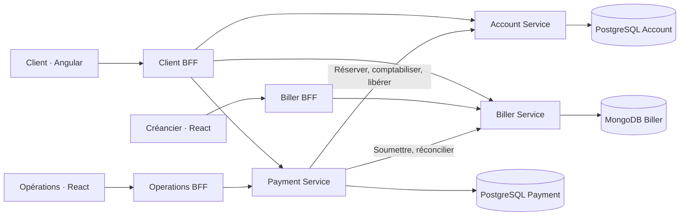

# Architecture cible et backlog

## Frontières métier

| Service | Possède | Interfaces envisagées |
| --- | --- | --- |
| Payment Service — Spring Boot, PostgreSQL dédié | Ordre, empreinte d'idempotence, état de saga et reçu | Confirmer, consulter l'ordre, obtenir le reçu, suivre la réconciliation. |
| Account Service — Spring Boot, PostgreSQL dédié | Comptes, réservations, soldes et journal équilibré | Consulter le disponible, réserver, comptabiliser, libérer et consulter le résultat par ordre. |
| Biller Service — Quarkus, MongoDB dédié | Créanciers fictifs, factures et décisions immédiates ou différées | Consulter la facture, soumettre un ordre, retrouver la décision durable. |

Les ports des domaines exposent les cas d'usage. Les adaptateurs portent le stockage et le transport. Les BFF composent les réponses et appliquent les besoins de présentation et d'accès de chaque espace. Les services métier appliquent leurs règles et contrôles d'accès. Les trois BFF sont hors décompte métier.

Le premier parcours propose des appels HTTP avec reprise persistée, dans le sens du diagramme. Chaque action distante doit pouvoir être interrogée ou rejouée avec la même identité. Le plan précisera contrats, migrations, verrous, unicité et stratégie de reprise. En particulier, il devra prouver l'atomicité de l'éligibilité de la facture et de la décision durable côté Biller Service, ainsi que la sérialisation des mutations du disponible côté Account Service.

## Compatibilité et outillage

La cible JVM est Java 27, selon le choix du propriétaire. Les versions stables retenues pour la tranche et les vérifications de compatibilité sont documentées dans la [recherche technique](../specs/001-pay-bill/research.md#java-frameworks-et-build). Les frameworks des jalons web seront vérifiés lors de leur introduction.

## Backlog progressif

| Jalon | Périmètre et justification | Preuve de sortie |
| --- | --- | --- |
| J0 — Socle SDD | Revue de la constitution, de la spécification et des arbitrages. | Décisions validées et critères traçables. |
| J1 — Parcours vertical | Trois services et trois bases via Compose, données de test, contrats HTTP, réservation et mouvement équilibré. | Paiement nominal avec reçu et concurrence sur le disponible vérifiée. |
| J2 — Robustesse MVP | Saga reprenable, décisions différées, réconciliation et démonstration des pannes. | Un même ordre converge après reprise, avec preuves corrélées et dossiers incertains visibles. |
| J3 — Espaces utilisateurs | Client Angular, puis vues créancier et opérations React avec BFF dédiés. Keycloak pour les identités fictives, rôles et contrôles d'accès inter-espaces. | Démonstration selon les rôles, avec tests d'accès et un reçu visible après succès. |
| J4 — Événements métier | Kafka pour exposer les faits métier à un consommateur indépendant. Debezium relaie une transactional outbox de Payment Service, avec identifiants stables et contrats versionnés. | Transaction annulée sans publication, émission après reprise et doublon absorbé. CDC brute sur tables fictives étudiée séparément. |
| J5 — Expériences ciblées | gRPC pour comparer un contrat typé sur une interface interne. WebFlux sur un BFF uniquement avec des dépendances non bloquantes et un besoin d'appels concurrents. Hazelcast pour une lecture de catalogue fictif tolérante à l'obsolescence. | Comparatif reproductible du contrat, de la latence et de la consommation de ressources. Invariants financiers inchangés cache désactivé. |
| J6 — Déploiement | Kubernetes pour éprouver redémarrage et déploiement, puis Istio pour observabilité, mTLS interne ou injection de délai contrôlée. | Déploiement local et reprise vérifiés. Mesurer la RAM avec les composants activés par jalon sur le poste de 32 Go. |

Les tâches seront découpées dans les `tasks.md` natifs à partir des plans revus. En particulier, faire précéder les essais distribués par les tests transactionnels des services propriétaires.
